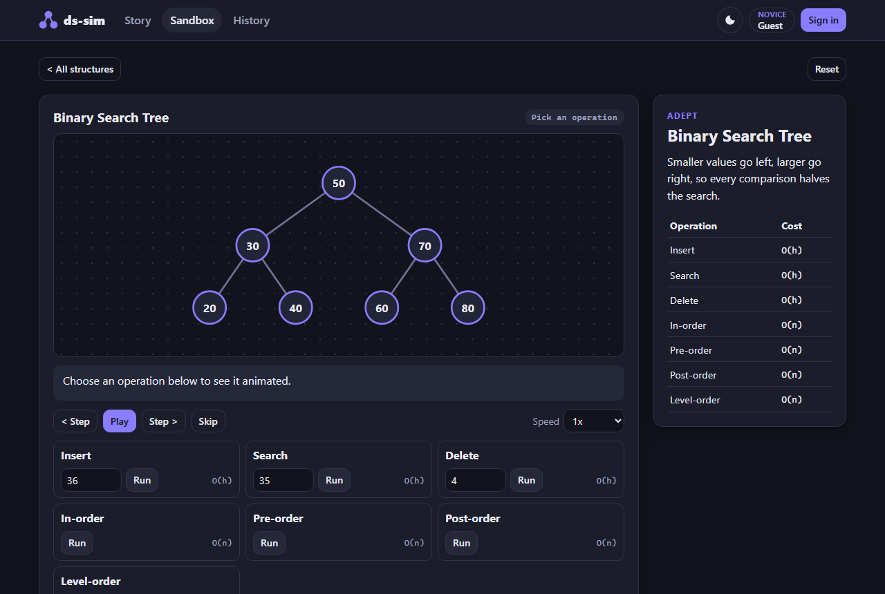
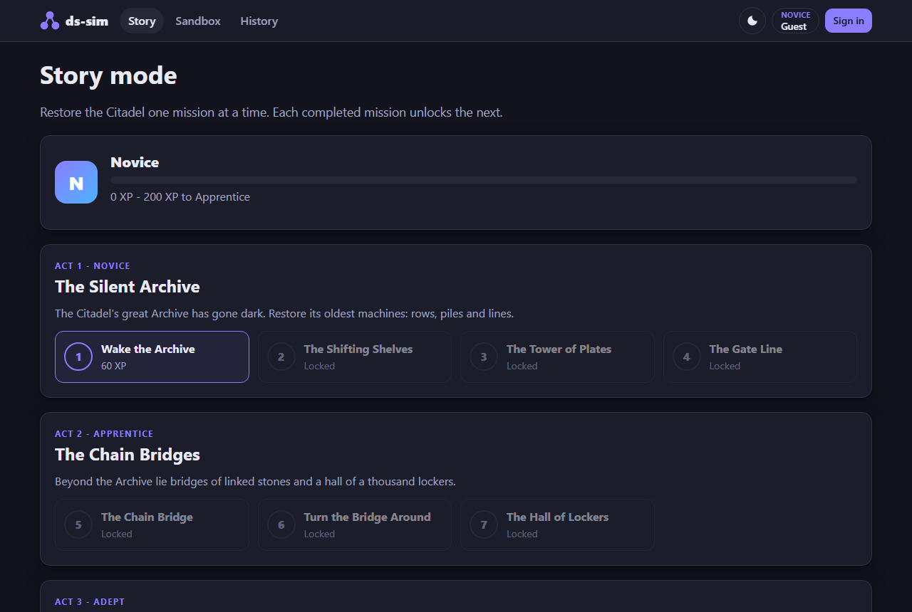
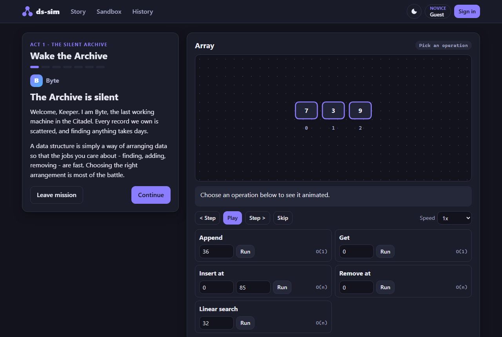
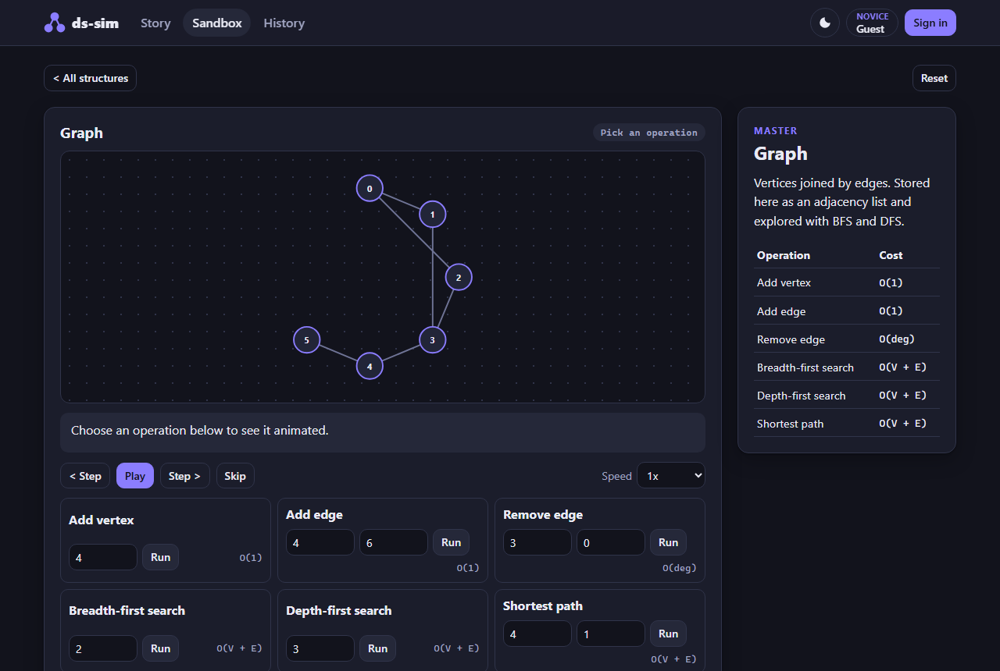

# ds-sim — Data Structure Simulator

**Learn data structures by watching them move.** ds-sim animates every comparison, shift, swap, pointer change and rotation step by step, and wraps the whole subject in a story campaign: 15 missions across 4 acts that take a complete beginner from "what is an array?" to AVL rotations, graph search and union-find.

**Live demo:** [ds-sim.centralindia.cloudapp.azure.com](https://ds-sim.centralindia.cloudapp.azure.com)



## Features

- **Story mode** – 15 missions in 4 acts (Novice → Apprentice → Adept → Master). Each mission mixes short lessons, hands-on tasks checked live in the simulator, and quizzes. Earn stars, XP, badges and ranks.
- **11 animated data structures** – array, stack, queue, singly linked list, hash table (separate chaining), binary search tree, min-heap (tree + array view), trie, AVL tree, graph (BFS, DFS, shortest path) and union-find (union by rank + path compression).
- **Step-by-step playback** – play, pause, step forward/back, skip, and change speed. Every frame has a plain-English explanation, and each operation shows its Big-O cost.
- **Accounts** – register with just a username and password (no email). Progress, settings and history sync across devices. Guest progress is merged into the account on sign-up.
- **Simulation history** – every operation is recorded and grouped into sessions that can be replayed.
- **Light and dark themes** – follows the operating system by default, switchable at any time.
- **Privacy built in** – data is encrypted at rest; users can download or permanently delete their data from the profile page.
- **Accessible and responsive** – keyboard navigable, screen-reader narration, respects `prefers-reduced-motion`, works on phones.

| Story map | Mission | Graph BFS |
| --- | --- | --- |
|  |  |  |

## Quick start

The only requirement is **[Node.js](https://nodejs.org) 20 or newer**. There are no dependencies to install.

| System | How to start |
| --- | --- |
| Windows | Double-click **`ds-sim.cmd`**, or run `ds-sim` in a terminal inside the folder |
| macOS / Linux | Run **`./ds-sim`** (or `sh ds-sim`) in a terminal inside the folder |
| Anywhere | `npm start` |

The launcher starts the server and opens <http://localhost:3000> in your browser. Use `PORT=4000 ./ds-sim` (or `set PORT=4000` on Windows) to pick a different port, and `--no-open` to skip opening the browser.

On first run a random encryption key is created in `data/master.key`. Keep it: without it, saved accounts cannot be read.

## Running the tests

```bash
npm test
```

The suite uses Node's built-in test runner and covers the HTTP API (auth, validation, CSRF protection, path traversal, encryption at rest, account export and deletion), the cryptography helpers and every data structure's logic. GitHub Actions runs it on Windows, macOS and Linux with Node 20, 22 and 24.

## Architecture

```
ds-sim/
├── server/                     Node.js HTTP server (no frameworks, no dependencies)
│   ├── index.js                Composition root – wires every dependency together
│   ├── app.js                  Request pipeline: security headers, rate limit, CSRF check, routing
│   ├── controllers/            HTTP only: parse request, call a service, send response
│   ├── services/               Business rules: auth, progress, history, account
│   ├── repositories/           Persistence behind small interfaces (users, sessions, encrypted documents)
│   ├── storage/                Atomic JSON file store
│   ├── security/               AES-256-GCM cipher, scrypt hasher, master key loader, rate limiter
│   ├── http/                   Router, cookies, body parsing, static files
│   └── domain/                 Validation rules and defaults
├── public/                     Browser app (vanilla ES modules, no build step)
│   ├── js/engine/              Structure base class, SVG renderer, animation player, tree layouts
│   ├── js/structures/          One class per data structure
│   ├── js/game/                Curriculum, mission runner, XP and ranks
│   ├── js/services/            Session, progress, history and theme services
│   ├── js/ui/                  Simulator panel, modal, toasts, celebrations
│   └── js/views/               One module per page
├── tests/                      node:test suites
├── deploy/Caddyfile            HTTPS reverse proxy config
├── Dockerfile, docker-compose.yml
└── ds-sim, ds-sim.cmd          Launchers
```

**How an animation works.** Each structure method calls `capture(message, marks)` at every teaching moment. A capture is a *scene*: a list of nodes, edges and labels with stable ids. The `SvgRenderer` matches elements by id between scenes, so nodes glide to new positions, new nodes fade in and removed nodes fade out, while edges are recomputed every frame to follow them. The `AnimationPlayer` steps through the scenes.

### SOLID in practice

| Principle | Where it shows up |
| --- | --- |
| **Single responsibility** | Controllers only speak HTTP, services hold rules, repositories persist, `DataCipher` only encrypts. On the client, `MissionRunner` holds mission logic while `missionView` only renders it. |
| **Open/closed** | New data structures are added by writing one `Structure` subclass and registering it; the renderer, player, sandbox and history need no changes. New API areas are new controllers with a `routes(router)` method. |
| **Liskov substitution** | `LocalProgressStore`/`RemoteProgressStore` and `LocalHistoryStore`/`RemoteHistoryStore` are interchangeable; guests and signed-in users run the same code. `BstStructure` and `AvlStructure` both work wherever a `BinaryTreeStructure` is expected. |
| **Interface segregation** | Repositories expose small, purpose-specific methods (`find`, `create`, `purgeExpired`, ...) instead of one generic data-access object. |
| **Dependency inversion** | Services receive their repositories, hasher and clock through constructors. `server/index.js` and `public/js/main.js` are the only places that choose concrete classes, which is also what makes the services easy to test. |

## Security

- Passwords are hashed with **scrypt** (N=16384, r=8, p=1, 16-byte salt) and compared in constant time. Failed sign-ins take the same time whether or not the user exists.
- All account data (username, password hash, progress and history) is **encrypted at rest with AES-256-GCM**. Every record has its own key, derived with HKDF from a master key, and is bound to its record id so ciphertexts cannot be swapped between records. Usernames are found through an HMAC blind index, so the database file contains no readable usernames.
- Sessions use 256-bit random tokens in `HttpOnly`, `SameSite=Strict` cookies (`Secure` and the `__Host-` prefix in production). Only a SHA-256 hash of each token is stored, and signing out revokes it on the server.
- Cross-site request forgery is blocked by `SameSite=Strict`, an Origin / `Sec-Fetch-Site` check on every state-changing request, and JSON-only bodies.
- A strict **Content Security Policy** (no inline scripts or styles, no third-party origins) plus `X-Frame-Options`, `nosniff`, `Referrer-Policy`, `Permissions-Policy` and HSTS over HTTPS.
- Rate limits on sign-in (per IP and per IP + username), registration and the whole API. Request bodies are size-limited and strictly validated, and the static file server rejects path traversal.
- No analytics, trackers, ads or third-party requests. The only cookie is the strictly necessary session cookie. See the in-app privacy notice.

Found a vulnerability? See [SECURITY.md](SECURITY.md).

## Configuration

| Variable | Default | Purpose |
| --- | --- | --- |
| `PORT` | `3000` | Port to listen on |
| `HOST` | `127.0.0.1` | Interface to bind (`0.0.0.0` inside Docker) |
| `DATA_DIR` | `./data` | Where the encrypted database lives |
| `DS_SIM_MASTER_KEY` | auto-generated file | 32-byte base64 key; **required** when `NODE_ENV=production` (`npm run keygen`) |
| `COOKIE_SECURE` | `true` in production | Mark cookies `Secure` (requires HTTPS) |
| `TRUST_PROXY` | `false` | Trust `X-Forwarded-For` from a reverse proxy |
| `SESSION_TTL_HOURS` | `168` | How long a sign-in lasts |

## Deployment

`docker-compose.yml` runs the app behind [Caddy](https://caddyserver.com), which obtains and renews an HTTPS certificate automatically. On a server with Docker:

```bash
cp .env.example .env    # then fill in DS_SIM_MASTER_KEY and SITE_ADDRESS
docker compose up -d --build
```

The live demo runs this exact setup on a small Ubuntu 24.04 virtual machine on Microsoft Azure (Central India). Only ports 80 and 443 are open to the internet, the master key is generated on the server and never leaves it, and the OS installs security updates automatically.

## License

[MIT](LICENSE)
